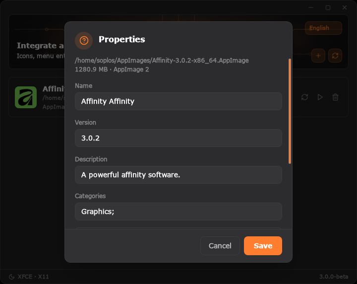
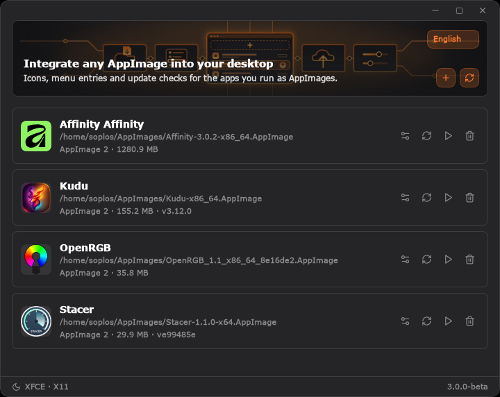

# Soplos AppImage Manager 3.0

[](https://www.gnu.org/licenses/gpl-3.0)
[]()

Integrate AppImage applications into the Soplos Linux desktop.

It moves AppImages into `~/AppImages/`, extracts their icon and metadata, creates a menu entry for them, and checks GitHub, GitLab and Codeberg for updates.

## Screenshots

| | |
|---|---|
|  **Main window**: hero banner, quick actions and integrated AppImages list |  **Properties**: edit name, version, categories, update URL and root privileges |
|  **Add dialog**: choose between moving original AppImage or copying it |  **Catalog**: integrated AppImages with icons, file size and version |
|  **Duplicate check**: duplicate detection when adding an existing AppImage | |

## Architecture

Version 3.0 is a ground-up rewrite of Soplos AppImage Manager. The original app was written in Python 3 with GTK3 (PyGObject). This rewrite replaces that entire stack with Tauri 2: a Rust backend and a Svelte 4 + Tailwind CSS frontend, rendered through the system's WebKitGTK.

- **Backend** (`src-tauri/`): every AppImage operation is plain filesystem work under the user's home directory (`~/AppImages/` and `~/.local/share/applications/`) — nothing needs root privileges except the per-AppImage opt-in "Run as root" launch flag via `pkexec`. Metadata and icon extraction prioritize `7z`/`7zz` (fast, non-intrusive) and fall back to `--appimage-extract` only when 7-Zip is unavailable, protected by an execution timeout. An asynchronous filesystem watcher monitors changes in `~/AppImages/` in real time.
- **Frontend** (`src/`): single-window interface with a hero banner (Add, Check-for-updates, language switcher), an AppImage cards list, and modal dialogs for properties, update notifications, and removal.
- **Streaming & Isolation**: downloads stream directly to disk without memory limits, and launched AppImages run detached in their own process group with redirected standard I/O.

## Installation

```bash
sudo apt install soplos-appimage-manager
```

## Features

- **Integration**: add an AppImage via file dialog or drag-and-drop; choose whether to move the file or keep a copy.
- **Metadata extraction**: automatic extraction of application icon, version, category, and comment.
- **Duplicate detection**: prevents duplicate entries when an AppImage with identical name/size is already integrated.
- **Customization**: edit application metadata, categories, update endpoints, and privileged execution flags at any time.
- **Updates**: check for updates against GitHub releases, GitLab releases, Codeberg, or custom HTTP URLs (single app or all apps).
- **Management**: launch, re-integrate, update, or completely uninstall AppImages along with their desktop files and cached icons.

## Keyboard shortcuts

| Shortcut | Action |
|---|---|
| F1 | Open About dialog |
| Ctrl+N | Add new AppImage |
| Ctrl+Q | Quit application |

## Documentation

A Unix manual page is included and installed with the package:

```bash
man soplos-appimage-manager
```

## Languages

The interface is available in 8 languages: English, Español, Deutsch, Français, Italiano, Português, Română and Русский. It starts in the system language and falls back to English. The language can be changed at any time from the hero banner.

## Building

```bash
npm install
npm run tauri dev      # development
./package.sh           # builds the .deb and moves it to ~/Descargas/SoplosApps
```

## License

Copyright © 2026 Sergi Perich <info@soploslinux.com>. Published under the GPL-3.0-or-later license. See `LICENSE`.

