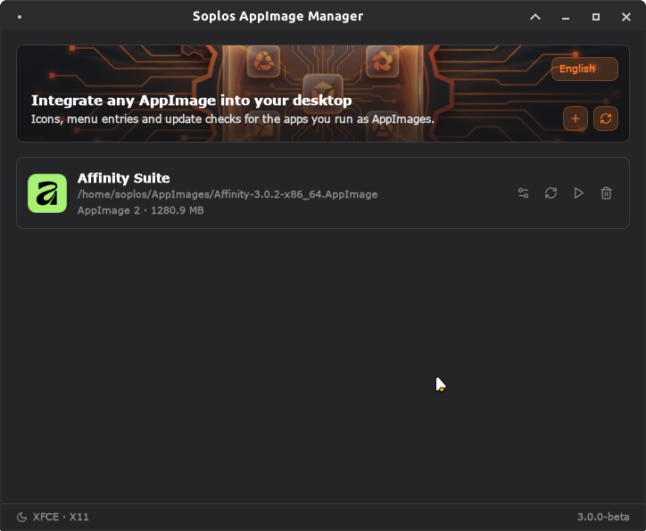
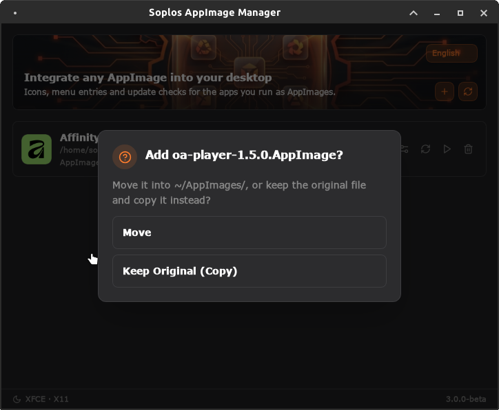
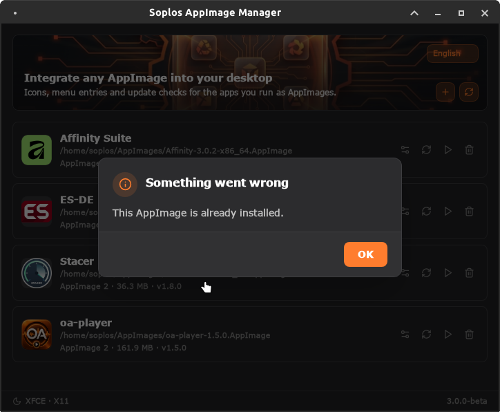

# Soplos AppImage Manager 3.0

Integrate AppImage applications into the Soplos Linux desktop.

It moves AppImages into `~/AppImages/`, extracts their icon and metadata, creates a menu entry for them, and checks GitHub, GitLab and Codeberg for updates.

## Screenshots

| | |
|---|---|
|  Main window with the hero banner and an integrated AppImage |  Editing an AppImage's name, version, description and categories |
|  Choosing whether to move the original file or keep a copy when adding |  Several AppImages integrated, each with its own icon, size and version |
|  Trying to add an AppImage that's already installed | |

## Architecture

Version 3.0 is a ground-up rewrite of Soplos AppImage Manager. The original app was written in Python 3 with GTK3 (PyGObject), the same skeleton every other Soplos GTK tool follows. This rewrite replaces that entire stack with Tauri 2: a Rust backend and a Svelte 4 + Tailwind CSS frontend, rendered through the system's WebKitGTK — the same architecture introduced by Soplos Welcome 3.0.

- **Backend** (`src-tauri/`): every AppImage operation is plain filesystem work under the user's own home directory (`~/AppImages/` and `~/.local/share/applications/`) — nothing needs root except the per-AppImage opt-in "Run as root" launch flag. Metadata and icon extraction try `7z`/`7zz` first (fast, never runs the AppImage itself) and fall back to `--appimage-extract` only when 7-Zip isn't available, both bounded by a timeout so a misbehaving third-party AppImage can't hang the app. A filesystem watcher keeps the list in sync when AppImages are added or removed outside the app. Every command that can take more than a few milliseconds runs off the main thread via `spawn_blocking`, so extraction, downloads and launching AppImages never freeze the window.
- **Frontend** (`src/`): a single-window app with a hero banner (Add/Check-for-updates actions, language switcher), a list of integrated AppImages, and shared popup components for properties, updates, deletion and errors.

This is the third Soplos application ported to this architecture, after Soplos Welcome 3.0 and Soplos WebApp Manager 3.0. The plan is to move the rest of the Python/GTK3 Soplos tools to the same pattern over time.

## Installation

```bash
sudo apt install soplos-appimage-manager
```

Open it from the applications menu. Press F1 for the About dialog.

## Features

- Add an AppImage by file picker or by dragging it onto the window; choose whether to move the original file into `~/AppImages/` or keep it and copy it instead.
- Automatic icon and metadata extraction (name, version, description, categories) from the AppImage itself.
- Detects when the same AppImage is already installed instead of silently creating a duplicate copy.
- Edit an AppImage's name, version, description, categories, update URL and "Run as root" flag at any time.
- Checks GitHub, GitLab and Codeberg releases, or a direct download URL, for updates — one at a time or all at once.
- Run, re-integrate or remove any AppImage from the list; removing deletes its desktop entry and extracted icon too.
- Keyboard shortcuts: F1 (About), Ctrl+N (Add), Ctrl+Q (quit).

## Languages

The interface is available in English, Spanish, German, French, Italian, Portuguese, Romanian and Russian. It starts in the system language and falls back to English. The language can be changed at any time from the hero banner.

## License

GPL-3.0-or-later. See `LICENSE`.
